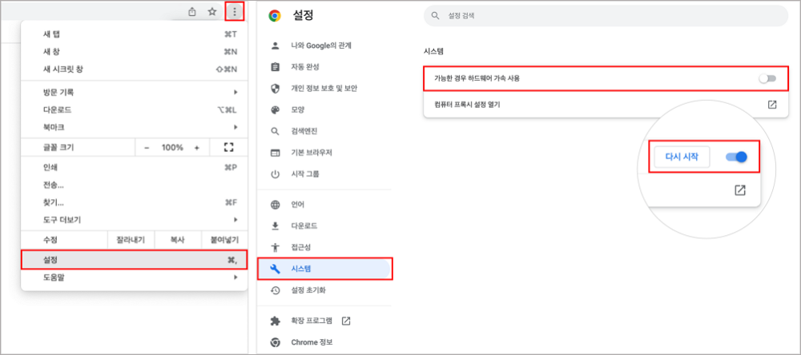
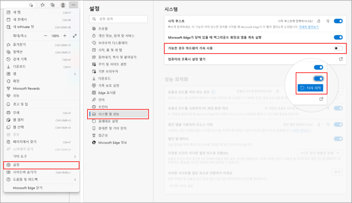
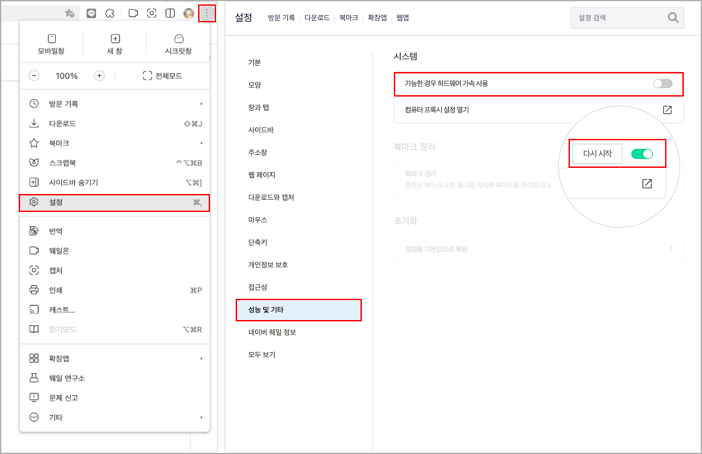

# 1. Google Chrome

#### 1) 브라우저 창 오른쪽 상단의 더보기(︙) 버튼 클릭 > 설정(Settings)
#### 2) 시스템(System) > 가능한 경우 그래픽 가속 사용(Use graphics acceleration when available) 켜기 > 다시 시작(Relaunch)

# 2. Microsoft Edge

#### 1) 브라우저 창 오른쪽 상단의 더보기(⋯) 버튼 클릭 > 설정(Settings)
#### 2) 시스템 및 성능(System and Performance) > 가능한 경우 그래픽 가속 사용(Use graphics acceleration when available) 켜기 > 다시 시작(Relaunch) 또는 자동 적용(Auto apply)

# 3. Naver Whale

#### 1) 브라우저 창 오른쪽 상단의 더보기(︙) 버튼 클릭 > 설정(Settings)
#### 2) 성능 및 기타(Performance and Others) > 가능한 경우 그래픽 가속 사용(Use graphics acceleration when available) 켜기 > 재시작(Restart)

# 4. Safari
#### Safari는 macOS Catalina(v10.15) 이상 버전부터 그래픽 가속이 자동으로 활성화됩니다.
